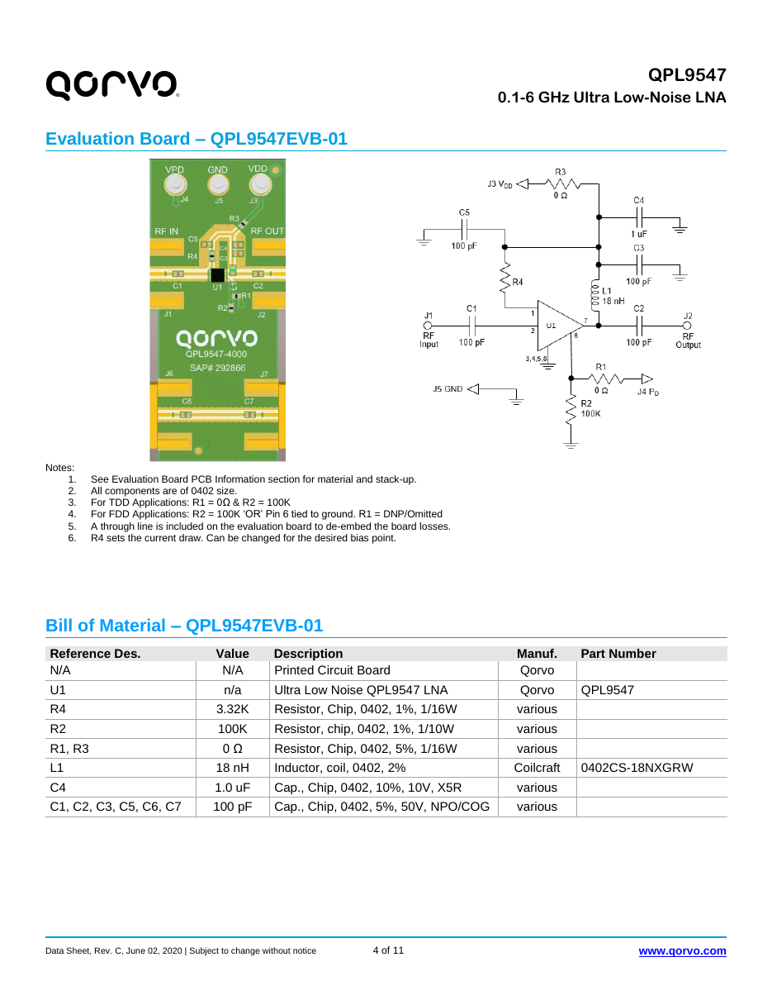
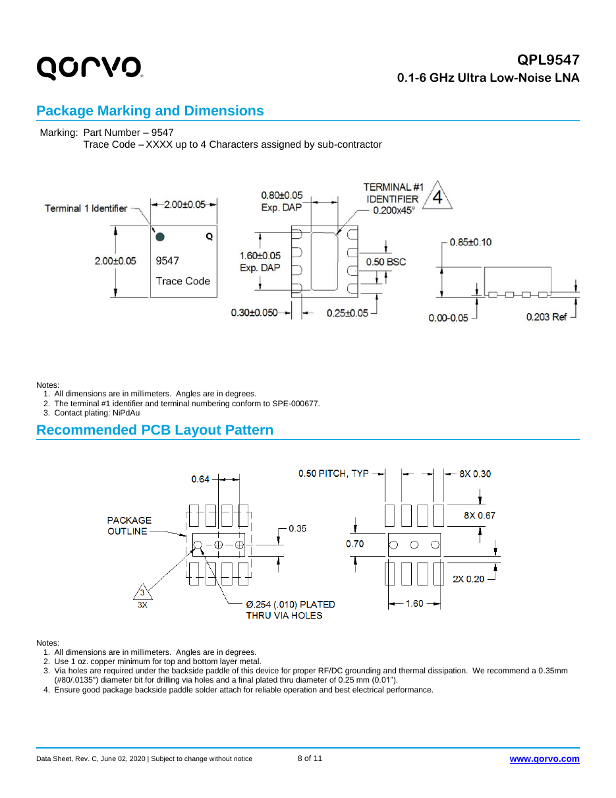
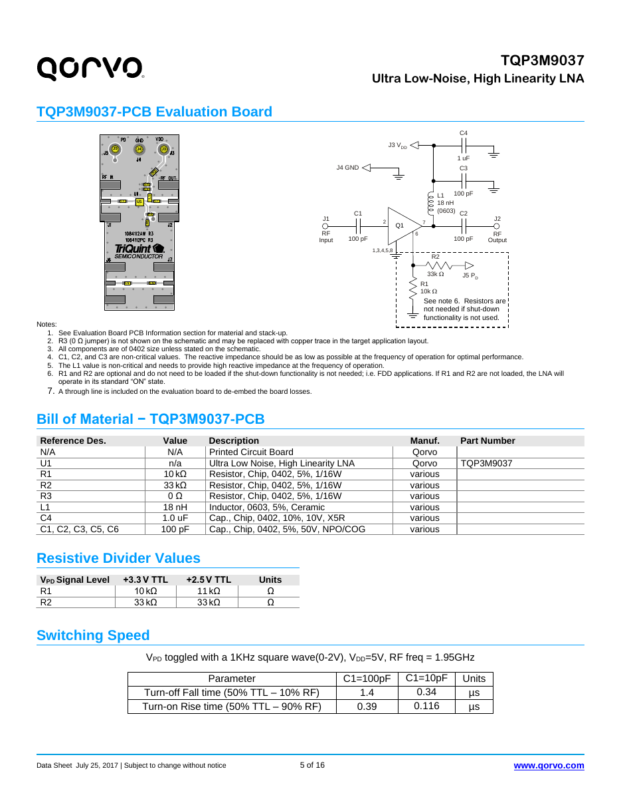
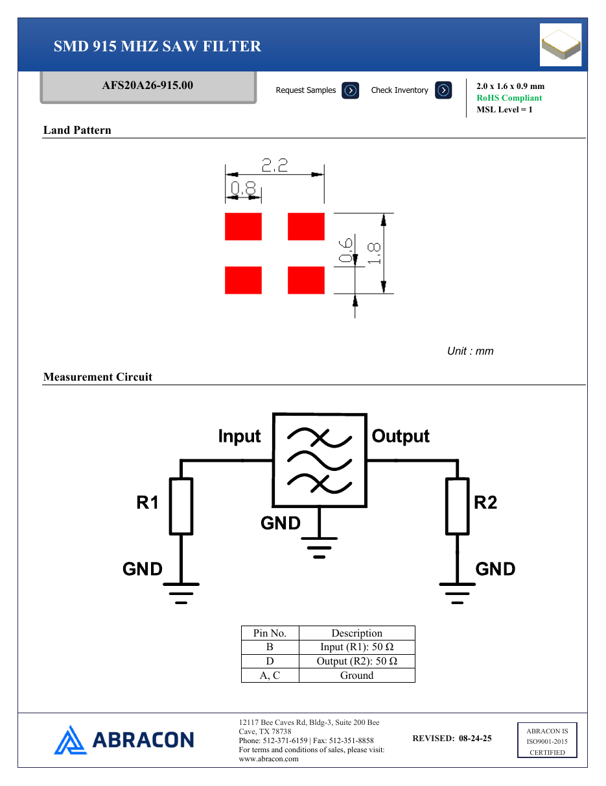
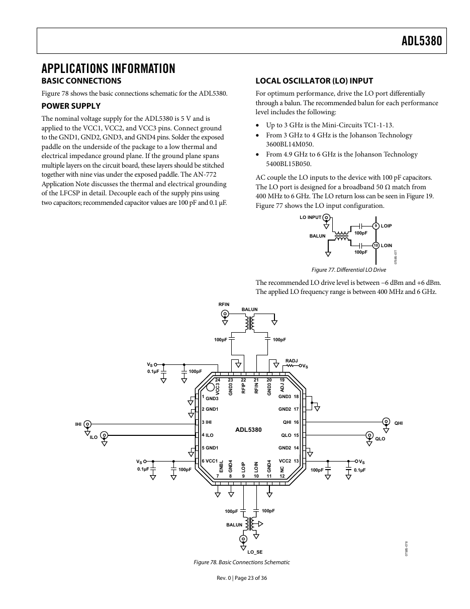

# Reference circuits

The manufacturer circuits each section of the board copies, with what was taken from
them. Page images are from the datasheets in the folder above.

## Qorvo QPL9547 LNA

Copied exactly into the FrontEnd sheet (refs match the project, not Qorvo's EVB):

- C1, C2: 100 pF DC blocks on RF in (pin 2) and RF out (pin 7).
- L2: 18 nH wirewound from the supply node to pin 7; RF out doubles as the supply pin.
- R4: 3.32 kΩ from the supply node to pin 1 (Vbias), sets about 65 mA.
- C3 100 pF, C4 1 µF, C5 100 pF bypass at the choke.
- R2 100 kΩ holds pin 6 (shutdown) low, so the LNA is always on.
- Pins 3, 4, 5, 8 NC to ground; paddle to ground with three vias.

Layout reference (land pattern and via placement):

## Qorvo TQP3M9037 (alternate LNA)

Same DFN-8 footprint and the same outside circuit, except pin 1 is NC: leave R4
unfitted when using this part.

## Abracon AFS20A26-915.00 SAW filter

50 Ω in and out with no matching parts. Pad B = input, D = output, A and C = ground,
with a via at each ground pad. Max input +15 dBm, max 3 V DC (hence C6 on the output).

## ADI ADL5380 I/Q demodulator

Copied into the Tuner sheet:

- RF: single-ended signal → TC1-1-13M+ balun → two **series** 100 pF caps → RFIP (22),
  RFIN (21). The RF input is about 50 Ω differential.
- LO: ADF4351 → TC1-1-13M+ balun → two series 100 pF caps → LOIP (9), LOIN (10).
  Drive between −6 and +6 dBm.
- VCC1, VCC2, VCC3 (6, 13, 24) at 5 V, each with 100 pF + 0.1 µF at the pin.
- ADJ (19): RADJ 1.5 kΩ to the same 5 V for operation below 3 GHz.
- ENBL (7) low = on. NC (12) unconnected.
- Exposed paddle to ground with nine vias; all GND pins straight to the plane.

## Mini-Circuits TC1-1-13M+ balun (pinout)

From the [datasheet](https://www.minicircuits.com/pdfs/TC1-1-13M+.pdf), case AT224-1A:

| Pin | Function | Connect to |
|---|---|---|
| 6 | Primary, dot | Single-ended input |
| 4 | Primary | GND |
| 1 | Secondary, dot | Series 100 pF → RFIP or LOIP |
| 3 | Secondary | Series 100 pF → RFIN or LOIN |
| 2 | Not used | Open |
